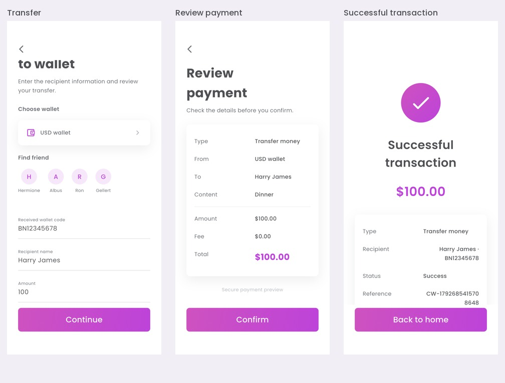
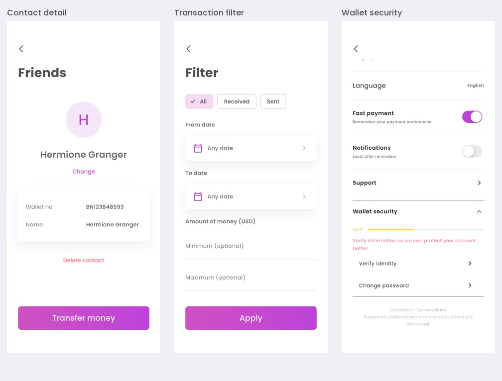
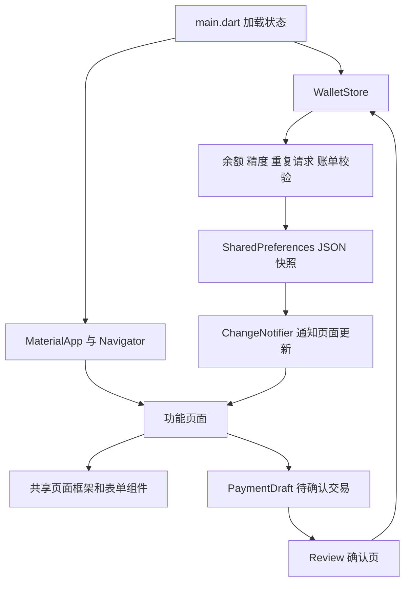

# CenWallet 项目结构与架构说明

## 1. 项目概览

CenWallet 是根据当前 Pixso 文件 `Page 1` 的钱包设计开发的 Flutter App。原稿共 91 个画板，包含页面、输入状态、选择弹层、确认页和结果页。实现时将同类状态组织为 48 个路由及复用组件，生成 64 张模拟器页面与状态截图。完整源画板记录见 [design-source.json](design-source.json)，对应关系见 [设计对应表](设计对应表.md)。

UI 保留 Poppins 字体、紫粉渐变、灰色标题、圆角卡片、钱包装饰圆形和五项底部导航。原稿透明画板使用白色页面背景；固定画布坐标改为 Flutter 流式布局，支持滚动、安全区与键盘避让。部分图标使用 Material 图标，修正原稿中的拼写错误和占位文案，因此不将本版描述为逐像素复刻。


## 2. 功能范围

| 模块 | 页面和交互 |
| --- | --- |
| 账户进入 | 欢迎页、三屏引导、登录、注册、忘记密码、验证码、新密码表单、指纹预览 |
| 钱包首页 | 钱包横向切换、充值/转账/换汇入口、近期交易、个人资料、二维码和更多菜单 |
| 资金流程 | 充值、向钱包转账、向银行转账、换汇、费用预览、统一确认、成功结果、复制收据 |
| 交易记录 | 搜索、收支类型、日期范围、USD 金额范围、交易详情、清空历史 |
| 支付服务 | 账单逐项或全部支付、服务分类、交通分类、商户收据 |
| 旅行预订 | 城市选择、推荐目的地、航班选择、日期、乘客数量、舱位、行李、付款钱包、行程确认 |
| 优惠 | 促销码查询、优惠详情弹层、复制优惠码、通知列表 |
| 联系人 | 搜索、新增、查看、修改、删除、发起转账 |
| 管理与设置 | 新建钱包、钱包图表、账户资料、通知和支付偏好、银行链接管理、身份验证表单、指纹偏好 |
| 支持 | 支持信息、问题报告、本地保存结果 |

五个底部入口依次为 Home、Incentive、Payment、Friends、Market。首页头像进入 Profile；右上角菜单进入 Setting、Manage wallet 和 Notifications。

### 转账流程

从首页点击 TRANSFER，再选择 To wallet。填写收款码、姓名和金额后进入 Review；点击 Confirm 才会提交本地交易，随后进入成功页。返回首页后，余额和近期交易立即更新。



### 辅助页面

联系人详情可以修改和删除联系人，筛选页面可以返回查询条件，设置页面的偏好会保存到设备。长页面的下半部分另有截图，避免遗漏行程总额和安全设置。



## 3. 目录结构

```text
CenWallet/
├── lib/
│   ├── main.dart                 # 启动、系统状态栏、本地状态加载
│   ├── app.dart                  # MaterialApp、页面构建与路由参数
│   ├── core/
│   │   ├── models.dart           # Currency / Wallet / Activity / Contact / PaymentDraft
│   │   ├── wallet_store.dart     # 本地状态、账本操作、持久化和失败回滚
│   │   ├── navigation.dart       # AppPage、导航方法、NavigatorKey
│   │   └── theme.dart            # 颜色、渐变、字体和主题
│   ├── widgets/
│   │   ├── ui.dart               # 页面框架、表单、卡片、选择器、金额/详情行
│   │   └── chart.dart            # 钱包曲线的 CustomPainter
│   └── features/
│       ├── auth.dart             # 欢迎、引导、登录注册和验证流程
│       ├── dashboard.dart        # 主导航、首页、优惠、支付、好友和行情
│       ├── finance.dart          # 资金表单、确认结果、历史、钱包与账户链接
│       ├── services.dart         # 账单、服务、机票信息和订单预览
│       ├── account.dart          # 个人资料、设置、账户、二维码和通知
│       └── secondary.dart        # 筛选、联系人详情、反馈、指纹和航班选择
├── assets/
│   ├── images/                   # 10 个实际使用的设计图片/插画
│   ├── fonts/                    # Poppins 四种字重及 OFL 许可
│   └── branding/icon.svg         # 应用图标矢量源文件
├── test/                         # 账本与页面交互测试
├── integration_test/app_test.dart # 设备流程验证和截图遍历
├── test_driver/screenshots.dart  # 宿主机接收 PNG
├── tools/                        # 一键检查和截图脚本
├── docs/                         # 架构、设计映射、验证记录与截图
├── ios/                          # iOS Runner 工程
├── android/                      # Android Runner 工程
├── pubspec.yaml                  # 依赖与资源声明
└── pubspec.lock                  # 已验证依赖版本
```

## 4. 架构与数据流

采用轻量的功能模块结构。Widget 负责页面和输入，`PaymentDraft` 表示不可变的待确认交易，`WalletStore` 负责业务校验和数据变更。`WalletScope` 基于 `InheritedNotifier` 向下提供状态；不额外引入 Provider、Riverpod 或路由框架。



### 状态与本地存储

- `WalletStore.load()` 在启动时恢复 JSON 快照；损坏或不兼容的数据使用初始演示状态。
- 钱包余额、交易、联系人、已支付账单、请求编号、用户资料、设置和本地反馈会被保存。
- 登录会话只保留在内存。密码、完整银行卡号、CVV 和身份证号不写入持久化快照。
- 页面通过共享状态刷新，不为每个界面复制同一份钱包数据。
- `mutate()` 为普通本地变更提供保存和回滚；交易在 `commit()` 中先校验再变更，保存失败时恢复先前快照。

### 金额和交易一致性

金额以最小单位的整数保存：USD/EUR 使用分，JPY 使用日元，BTC 使用 10⁻⁸ BTC。金额解析与展示不依赖浮点数拆分，限制小数精度、非正数和无效输入。

确认页面生成稳定的请求编号，并在提交期间禁用重复操作。账本拒绝重复请求、余额不足、重复支付账单、相同币种换汇和无效目标钱包。换汇会同时扣减源钱包并增加目标钱包；目标钱包检查发生在任何扣款之前。

本地换汇使用设计演示汇率并按目标最小单位四舍五入。钱包图表和市场报价是设计参考数据；它们不是联网市场行情。初始余额与历史样例分别作为演示种子，新增交易则按账本规则更新余额。

### 页面复用与代码精简

充值、钱包转账、银行转账和换汇共用资金表单；所有资金操作共用确认页与成功页；账户、联系人和密码复用表单框架。`PageFrame` / `PageBody` 统一标题、滚动和底部按钮，`WalletChoice` 统一钱包选择，`DetailRow` 统一收据排版。

已移除 Pixso 导出中未使用的绝对定位代码、默认计数器页面、无用图片、Cupertino 图标依赖和模板注释。运行时仅保留 `flutter_svg`、`shared_preferences`、`qr_flutter` 三个直接第三方依赖。各控制器在组件销毁时释放。

## 5. 运行与复现

```bash
flutter pub get
flutter run
```

首次进入：Let’s begin → Skip → Explore demo。演示验证码：`F2368`。促销码：`F26748`。

```bash
# 格式、静态检查和测试
./tools/verify.sh

# 在指定设备执行集成验证并重新生成所有截图
flutter devices
./tools/capture_screenshots.sh DEVICE_ID

# 构建 iOS 模拟器 App
flutter build ios --simulator --debug
```

本次设备：iPhone 16e / iOS 26.0，截图分辨率 1170 × 2532。截图是模拟器中运行的 Flutter 应用窗口，使用 `integration_test` 原生截图能力生成。

## 6. 演示边界与后续接入

本版交付的是可运行的 UI 和本地业务原型。登录和密码重置只演示输入与导航；短信验证码固定；指纹页面只保存偏好，不注册或验证系统指纹。身份页面不上传证件照片，银行页面不连接金融机构，交易不发送到支付网络，机票不生成真实订单，反馈只在设备本地保存。

二维码由真实编码组件生成，Scan 提供手动输入收款码的替代流程，未接相机识别。交通分类中的列车、巴士和出租车保留分类入口提示，已实现的预订流程为机票。界面语言为英文，语言选择当前仅提供 English。

将来接入服务时，可在 `WalletStore` 后增加远端 Repository，把身份、余额、幂等请求和订单校验交给服务端；页面继续使用相同的待确认模型。真实密钥与认证令牌应由独立的安全存储方案管理。

实际验证结果、Android 构建限制及重跑方法见 [验证记录](验证记录.md)。
